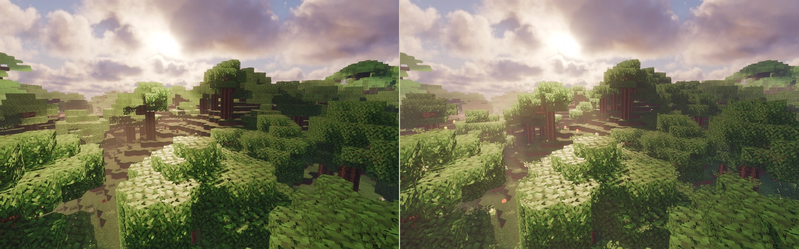

# 0.142 · 林冠、光照和材质采样

晨光镜头看两处：左侧树干能否在薄雾中依次分开，右侧背光树冠能否保住层次。日间用同一存档看叶簇边缘和地面受光。两版都用种子 624、光影档、固定曝光、1280×800。

| 差距                                           | 渲染路径的变化                                                                                                                                                                                                                                               |
| ---------------------------------------------- | ------------------------------------------------------------------------------------------------------------------------------------------------------------------------------------------------------------------------------------------------------------ |
| 叶块轮廓在动，表面明暗仍贴着原来的平面         | 近景天然树叶朝空面伸出由当前资源包叶色裁出的枝梢。叶块和草花按变形后的三角面求法线，叶纹明暗提供微法线；透明孔洞不产生凹坑。装饰梢与原叶共用风、阴影和区块绘制，方块选取仍落在原轮廓上。                                                                     |
| 木纹、石纹的竖向起伏偏弱，远处高光跳动         | 原来用整张长图集的归一化 UV 构造切线基，图集越高，纵向斜率越小。现在两轴统一到纹素单位。法线、粗糙度与高度按像素覆盖面积取 mip，最大足迹限制在单个图块；金属分类等离散通道继续点采样。                                                                       |
| 低天光区域即便有阳光穿过，仍被天光阈值再次压暗 | 阴影图内由几何遮挡决定直射，极低天光处防漏光；到边界平滑切回天光近似。光影档阴影图从 48×48 扩至 96×96 世界单位，仍为 2048²；单位长度纹素密度随之减半。林下低天光表面多取向上的天空辐照度。风与阴影按同一世界时钟更新，光影档的周期从 250 ms 缩短到约 42 ms。 |
| 晨雾集中在低处，中景体积光缺少遮挡变化         | 海面为 5.15。Rayleigh 和 Mie 从海面上方 30 和 7 开始衰减，半衰高度各为 30 和 7；天空、反射和主视图共享高度参数。原来 58 单位以外的整段空气只取一次光照，现在 24 个积分区间分布到整条可见空气路径，近密远疏。边界雾和视距沿用原设置。                         |
| 横移时，叶隙会在天空和前景深度之间跳变         | 原尺寸 TAA 从已有的 3×3 邻域选取前景运动，在轮廓处重投影；保留原有当前帧重建滤波。新出现的物体、手部和透明动态物体继续走反应遮罩。                                                                                                                           |

Photon 对照提交为 [6e67b36](https://github.com/sixthsurge/photon/tree/6e67b36e818bacde0304edd49f28e2bb70e33f04/shaders)。移植的关键是输入：雾高相对海面、阴影是否覆盖当前接收点、切线的两个轴如何度量、历史像素来自哪个表面。枝梢造型是对六棱树冠的适配。

## 还看得到的差距

中远景仍由分层六棱树冠与简化树木模型构成；调雾无法补出参考图里起伏的连片树冠。天空晴间云的覆盖和太阳露出程度也会改变整片森林的亮度。当前 AO 在前向场景颜色之后合成；遮蔽方向仍未完整参与间接光照。继续提高贴图分辨率对这三项的帮助有限。

## 在游戏中验证

Edge 后台实帧对比覆盖晨光、日间和 36 帧风动。切换时刻后两版都等太阳光照发布，刷新阴影图，再等历史收敛。日间继续正常运行 64 帧，441 个近景区块、169 片远景，两次 GPU 计时均无 disjoint。该机 1280×800 的整帧 GPU 中位数为 **32.85 → 36.92 ms**；加宽并加快刷新阴影、增加枝梢和材质采样都有成本。

- 双轴等斜率输入在 GPU 上读回 R/G 各 166（8-bit）；叶片透明孔洞的法线保持平坦。实际射线可选中原叶块，跳过外伸枝梢。资源包覆盖、还原默认、图形设备恢复与金属高光检查通过。
- 栅栏、台阶与立柱的静态场景使用 2× 渲染作参考。0.142 的 TAA 边缘均方误差为 118.79，同版 SMAA 为 187.84；0.141 的相应值为 107.43 和 215.08。两版各自与自己的高分辨率画面比较，表面着色也发生了变化。这一轮的抗锯齿重点是运动轮廓；静态测试尚无跨版本领先结果。
- 移动物体的颜色对照改为同一帧、同一抖动相位的 TAA **输入 HDR**，避开旧测试拿后续曝光与空间抗锯齿输出作基准的问题。0.141 的旧基准也超出原阈值（0.08172，阈值 0.08）。新测试保持阈值不变；0.142 新位置与让出位置的 RGB 均值绝对差之和分别为 0.000132、0.000037。
- 本地复现：`npx playwright test --config tests/canopy-light.config.js canopy-light.spec.js`。该场景使用独立端口 5193 和模拟 Pointer Lock。
