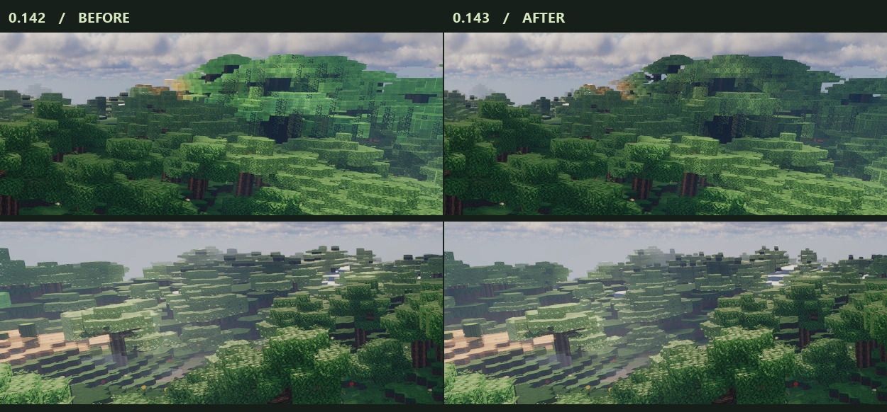

# 0.143 · 远林轮廓与天光

同一片种子 624 的森林，左为 0.142，右为 0.143。上排看右坡丛林叶的颜色与孔隙，下排看远处树梢和树下的明暗。两排均从 1280 × 800 游戏实帧按相同坐标裁切。

**丛林叶。** 此前丛林叶在 16 × 16 的不透明底上画色点，树梢和阴影也继承了整块实心轮廓。默认材质现采用 [Pixel Perfection / VoxeLibre 的丛林叶](https://github.com/VoxeLibre/VoxeLibre/blob/4492ce6ff8d856daa4567abe2ea689f4e7a39842/textures/default_jungleleaves.png)，游戏图集保留 59 个透明纹素。方块表面、边缘叶簇、叶脉法线与阴影深度使用同一张源图；导入资源包仍优先。

**远树轮廓。** 远景原先把水平 2 × 2 范围的少量叶块扩成整层。单柱细树干、上方空出的单列或双列树梢现在使用原有世界方块的坐标与树种。密实部分继续合并；玩家编辑沿用精确格。世界生成、碰撞和存档保持原样。

**远景光照。** 此前远景顶点的天光一律为满值。[Photon 的漫反射着色](https://github.com/sixthsurge/photon/blob/6e67b36e818bacde0304edd49f28e2bb70e33f04/shaders/include/lighting/diffuse_lighting.glsl)用天光等级的平方调节环境光。现在近远景共用垂直天光计算；远景在 Worker 里再传播三格，屋檐和树下能接到侧面的光。连续相同的天光等级合并存储，随地形片传给渲染器。着色时在可见面外侧取样，按天光等级的平方计算亮度；远叶的透射也随遮蔽减弱。这是固定范围天光近似；远处仍没有完整的方向性投影。

**开销。** 晴天日间、光影档、固定曝光，后台 Edge / D3D11，同一机位分别采样 64 个正常渲染帧。整帧 GPU 中位 **41.43 → 40.87 ms**，两次均无 disjoint。169 片远景的常驻网格从 1,118,380 增至 1,485,062 个三角形；属性和索引的存储从 76.6 增至 101.1 MiB。此机位有 106 片进入雾距筛选后的候选集，再由相机视锥裁剪。雾的起止距离和可玩视距沿用原值。

**复现。** `npx playwright test --config tests/canopy-light.config.js forest-depth.spec.js`。屋顶跨片与开洞见 `tests/distant-ambient.test.js`；树干和梢部占据见 `tests/distant-architecture.test.js`。中央近景仍能看出六棱块面；下一步可用冠层邻域方向调整受光法线，同时保留玩家搭建的叶墙形状。
