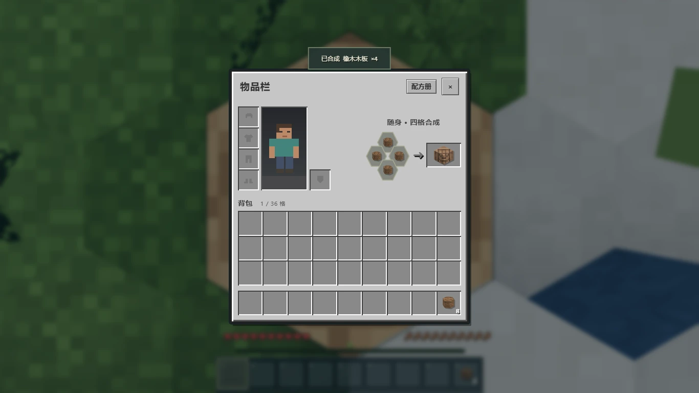
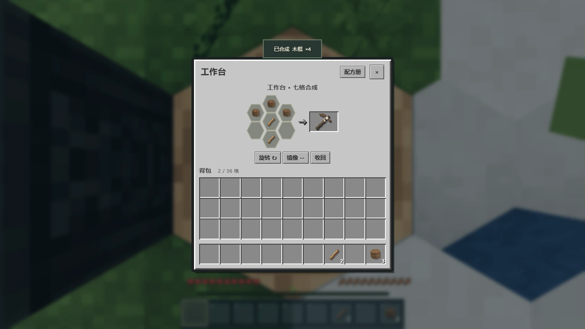
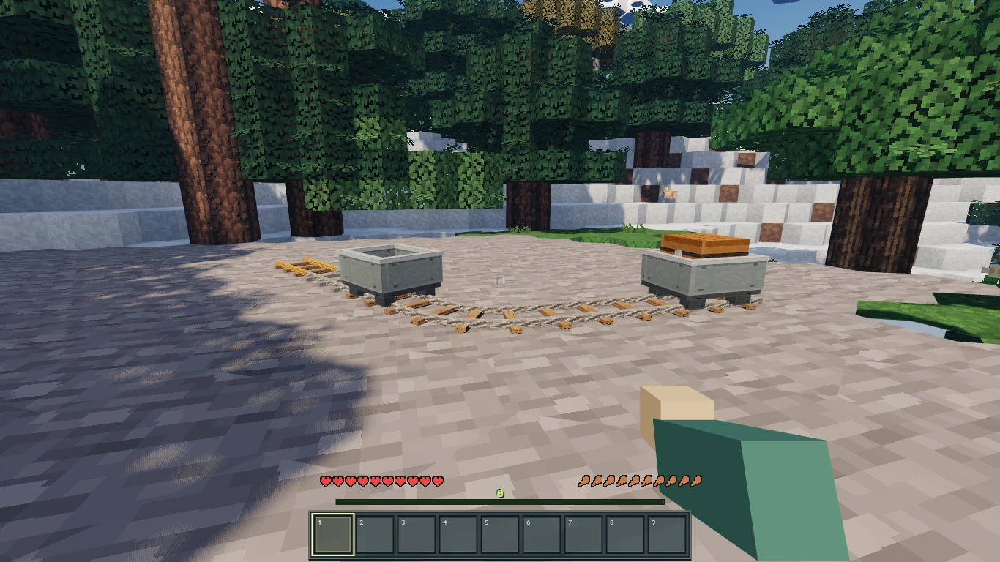
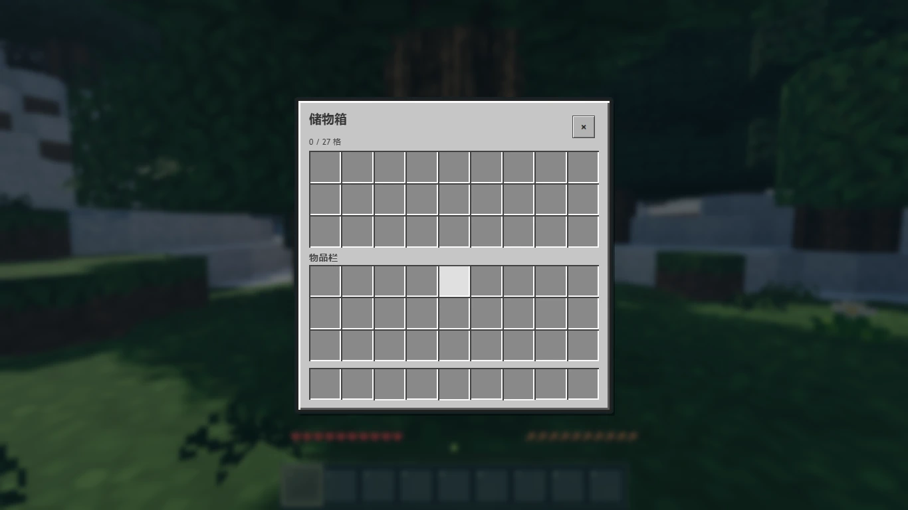
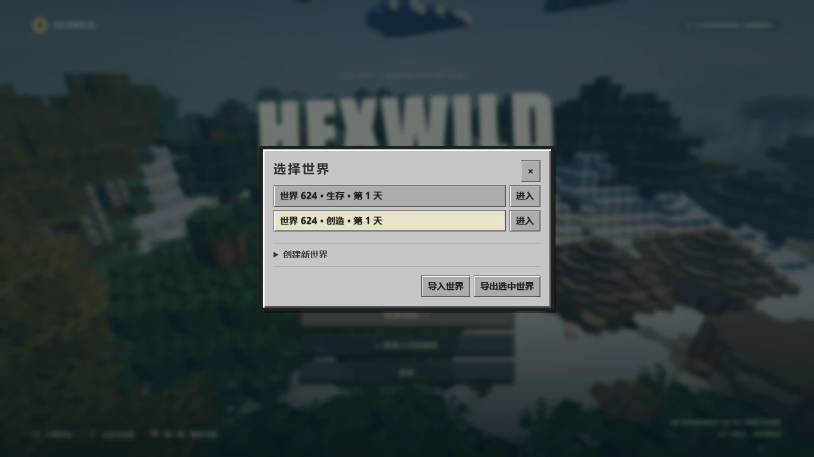

# 蜂巢生存与六向铁路

## 从空手到第一炉铁

| 在哪里           | 摆法                                 | 拿到什么      |
| ---------------- | ------------------------------------ | ------------- |
| 随身，按 E       | 任意一格放一根原木                   | 同树种木板 ×4 |
| 随身             | 木板铺满四格菱形                     | 工作台        |
| 随身             | 两块木板相邻                         | 木棍 ×4       |
| 工作台，右键打开 | 上方三格放木板，中央和正下方放木棍   | 木镐          |
| 工作台           | 把镐头换成三块圆石；两根木棍仍作柄   | 石镐          |
| 工作台           | 六块圆石围一圈，中央留空             | 熔炉          |
| 熔炉             | 石镐采得的粗铁放原料槽，煤炭放燃料槽 | 铁锭          |

三根原木足够做出工作台和木镐。站在工作台旁按 E 仍是四格。配方册列出当前盘面能制作的图案；点击配方填料，点击产物才扣料。工作台接受同一图案的六向旋转与镜像。每个占用格每批扣一件；Shift 点击产物连续制作，背包放不下完整一批时停止。

[同一生存档烧出的第一块铁](media/hex-survival/first-iron.webp)。

## 修一条矿线

对准支撑面铺轨，浅色线显示即将接通的两个端口。普通轨可以转 60°，相邻轨可以高低差一格。铺支线时会保留已有的两端连接；想改向，拆下交会格，从支线方向重新铺。动力轨和探测轨保持直线。

对准轨道放矿车，右键车厢乘坐，W 推车，Shift 在旁边有落脚点时下车。通电的动力轨加速，断电时制动。运输矿车右键开箱，经过探测轨会触发相邻红石机关。把末端轨道铺在漏斗上，漏斗的出口接箱子，即可卸货。废弃矿井的残轨与战利品矿车只生成一次。

## 背包、容器和世界

- 左键拿放整组、右键分半或放一件；拖动分配、Shift 快移、数字键换栏、F 换副手。窄屏在配方页与背包间切换时保留光标栈。
- 箱子与熔炉使用相同位置的 27 格背包和九格快捷栏。炉火消耗和烧炼进度单独刷新，漏斗运输也保留现有槽位节点。
- 默认 HUD 显示生存状态、经验与快捷栏。F3 展开世界信息，M 打开地图。创造背包按类筛选，名称和物品 ID 均可搜索；销毁槽清除光标上的物品。
- 世界列表可以分别进入、新建、导入或导出各个世界。v16 自动档升至 v17 时保留原始存储项；七格旧料与光标先归还背包，满包余量落在脚边。矿车的轨段、段内位置、行驶方向、速度、乘坐关系和货物按维度保存。

[查看生存 HUD](media/hex-survival/hud.webp) · [对照熔炉的背包位置](media/hex-survival/furnace.webp) · [创造搜索「铁轨」](media/hex-survival/creative.webp)

## 本地复验

运行 `npm test` 检查配方、存档、轨道连接、矿车动力、红石、漏斗与天然矿井。运行 `npx playwright test -c tests/hex-survival.config.js` 走后台 Edge 的开局与铁路操作；使用独立测试端口，并模拟 Pointer Lock。截图保存在该配置的 Playwright 输出目录。
