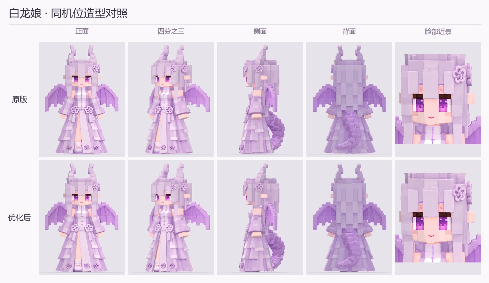
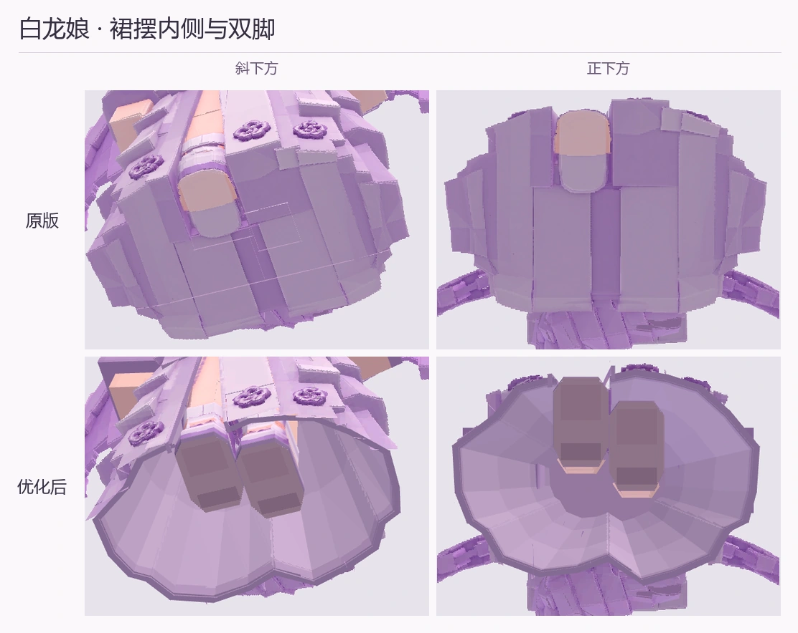
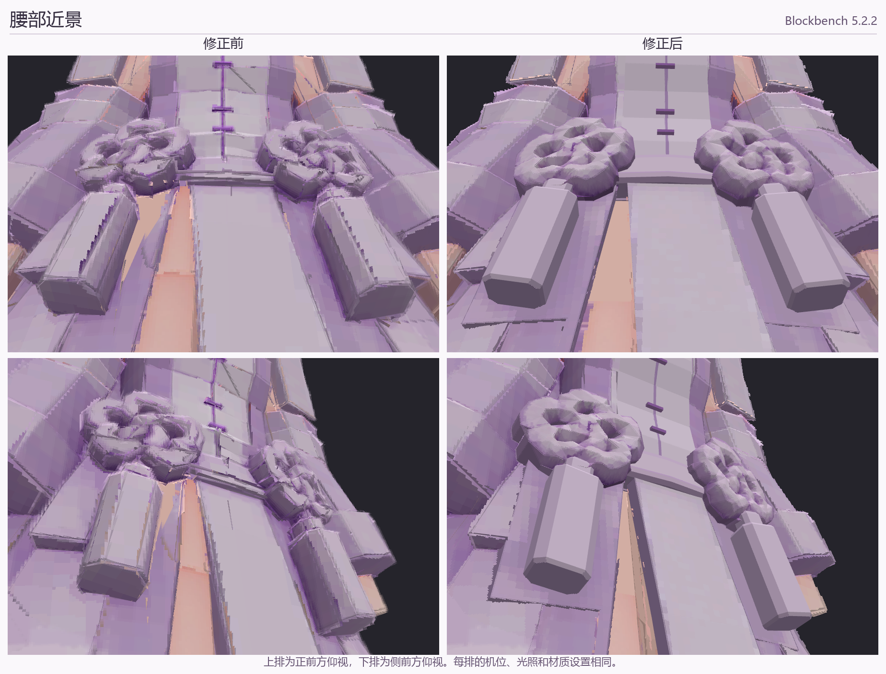

# 霜珠 · 白龙娘

[下载 YSM 包](../public/models/pearl-dragon-hy.zip) · [可编辑的 Blockbench 工程](../art/models/Pearl-Dragon-HY.bbmodel) · [腰部近景修正](media/pearl-hy/waist-review.webp) · [同机位纯色对照](media/pearl-hy/surface-clay.webp) · [裙摆底部对照](media/pearl-hy/hem-review.webp)



**在另一台机器看效果**：打开六野，按两次 **F5** 看正面，按 **E** 看背包预览。曾经导入过其他角色，可以在「选项 → 角色模型 → 恢复白龙娘」切回。也可以直接用 Blockbench 打开上方工程，贴图和第三人称动作均已内嵌。游玩和编辑都无需混元源文件。

**Minecraft Java / YSM**：将 ZIP 放进实例的 `config/yes_steve_model/custom/`，执行 `/ysm model reload`，在模型菜单选择「六野 · 白龙娘」。如果已有同名旧包，先移出旧包。[官方模型格式和安装目录](https://yesstevemodel.github.io/wiki/type/)

## 造型与裙摆修复

本版以原有 YSM 表面为基准，在同一骨骼内合并相邻、朝向接近的面片。发束、翅膀和尾巴按更小的平面偏差处理，翼缘缺口和鳞片折角仍由几何表现。发丝、衣料与翼膜的小幅明暗变化按模型空间的像素格归色。原有眼部细节、花纹和装饰起伏继续保留。[角色设定图](../art/models/pearl-target-front.png) · [混元原模与初版 YSM 对照](media/pearl-hy/hy-native.webp)

原模在裙底生成了大块封面，遮住了双脚。现在裙摆内侧沿实际下摆收向腰部，前方保留开衩。两条腿各有膝关节和鞋底，鞋面沿用原先露出那只鞋的配色与绘制细节。



上一版的花扣、垂带和裙缝由多层带半透明边缘的薄片拼成。贴近腰部仰视时，相邻薄片会同时露出来，形成断续的双边。现在的花扣从原有饰件取色和测高，五瓣、镂孔及侧壁都有几何起伏。两根垂带改为闭合的八棱柱，各与对应的花扣一起随裙片摆动。前襟和裙衩用连续衣片收边，衣料贴图采用二值透明轮廓。



「大正女仆酒狐」的 Bedrock 工程用来对照侧发、前臂、眼部表现与分段尾巴的组织方式。白龙娘的眼部变化使用局部覆盖；常态保留混元的脸。正面开衩中露出的鞋跟随同一条腿，左右袖、前裙和七段尾链分别运动。第一人称只加载手臂、前臂与握持点。第一人称动作沿用 [YSM 官方 Default 的 CC0 手臂动画](https://github.com/YesSteveModel/YesSteveModel/tree/15c2c25f5b50f54ee099bc474483dc4b588d956d/src/main/resources/assets/ysm/builtin/default)。

| 几何         | 原版面片 | 本版面片 | 本版三角面 |  减幅 |
| ------------ | -------: | -------: | ---------: | ----: |
| 第三人称     |    7,809 |    6,040 |     12,080 | 22.7% |
| 第一人称双臂 |      615 |      425 |        850 | 30.9% |

为修复腰部近景，本版比上一次减面版增加 540 个面片，合计 1,080 个三角面。相对初版的 15,618 个三角面，仍减少 3,538 个。

模型包采用 YSM spec 2，第三人称保留 33 根骨骼和 20 个动作，第一人称双臂保留 6 根骨骼和 57 个动作，共用一张 2048 × 4096 图集。全身和裙底对照从 YSM 包渲染，腰部近景从重新打开的 Blockbench 工程截取。独立 Minecraft 实例的穿戴实测留待后续。

## 从源网格重新制作

在仓库根目录用 Python 3.12 虚拟环境运行以下命令。前两个命令重建模型包；导出可编辑工程需要已安装的 Microsoft Edge 和可访问的 Blockbench 网页版。四机位对照在本机读取 GLB。

```sh
python -m pip install -r tools/pearl_hy/requirements.txt
python tools/pearl_hy/build.py "path/to/hunyuan.glb"
node tools/editable-dragon.mjs public/models/pearl-dragon-hy.zip art/models/Pearl-Dragon-HY.bbmodel
node tools/pearl_hy/review.mjs test-results/pearl-hy --motion
node tools/pearl_hy/reference.mjs "path/to/hunyuan.glb" test-results/pearl-hy/final-compare
python tools/pearl_hy/sheet.py
```

[早期白龙娘与牧场生物](pearl-dragon-0147.md)
