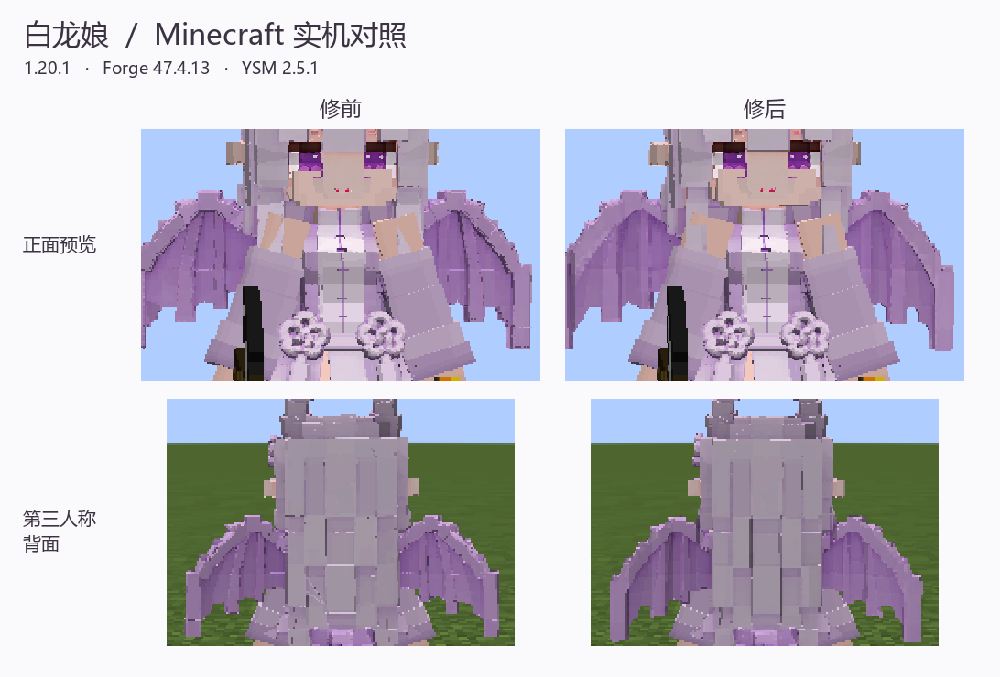
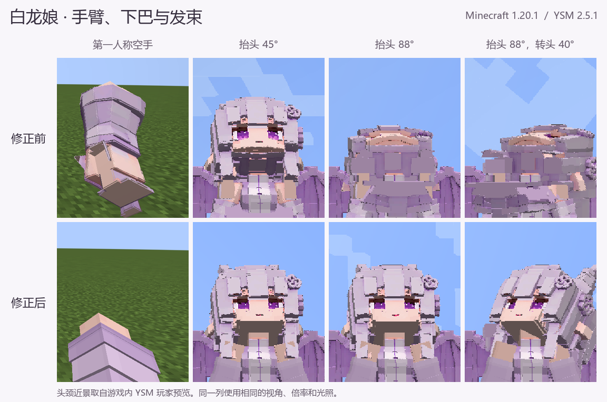

# 霜珠 · 白龙娘

[下载 YSM 包](../public/models/pearl-dragon-hy.zip) · [可编辑的 Blockbench 工程](../art/models/Pearl-Dragon-HY.bbmodel) · [可编辑的第一人称双臂](../art/models/Pearl-Dragon-HY-Arm.bbmodel) · [腰部近景修正](media/pearl-hy/waist-review.webp) · [同机位纯色对照](media/pearl-hy/surface-clay.webp) · [裙摆底部对照](media/pearl-hy/hem-review.webp)



**在另一台机器看效果**：打开六野，按两次 **F5** 看正面，按 **E** 看背包预览。曾经导入过其他角色，可以在「选项 → 角色模型 → 恢复白龙娘」切回。也可以直接用 Blockbench 打开上方工程，贴图和第三人称动作均已内嵌。游玩和编辑都无需混元源文件。

**Minecraft Java / YSM**：将 ZIP 放进实例的 `config/yes_steve_model/custom/`，执行 `/ysm model reload`，按 **Alt + Y** 打开模型菜单并选择「六野 · 白龙娘」。如果已有同名旧包，先移出旧包。[官方模型格式和安装目录](https://yesstevemodel.github.io/wiki/type/)

## 翼膜、发束和衣褶的碎边

两翼按原翼面的深度拟合折线。正面和背面沿同一组折线接合，凸起的翼缘有独立的厚度和侧壁。翼顶的小块和翼根下方的衣褶沿用原表面。后发与两侧发束按实际截面分层，每段侧壁使用完全不透明的矩形面。裙片只在平坦衣料上合并近似共面的碎片，保留裙衩、立体花扣和下摆绣纹。[四机位贴图与纯色对照](media/pearl-hy/folds-review.webp)

用发布包在角色室固定姿势、光照和分辨率（520 × 690），从后侧缓慢转动约 8°，共取 25 帧。统计表面内部比相邻两帧同时亮或暗至少 12 个灰度级的像素，占三帧共同内部像素的比例。后发与侧发从 0.239% 降至 0.045%，双翼从 0.183% 降至 0.161%，躯干与裙片从 0.153% 降至 0.147%。斜视翼根和裙褶时仍有零星细缝。另用 16 个固定水平机位比较整身外轮廓，修前与修后的平均交并比为 99.4%。

本次增加了翼缘侧壁，双翼从 691 个元素增至 776 个。三束活动头发从 428 个元素减至 261 个。尾巴、眼部表情、颈部和两套手臂的几何及贴图像素均与上一版逐面核对。实机另检查了第三人称正背面、背包、抬头转向、主手铁镐和副手火把。[实机局部对照](media/pearl-hy/mc-folds.webp)

## 造型与裙摆修复

本版以原有 YSM 表面为基准，在同一骨骼内合并相邻、朝向接近的面片。发束、翅膀和尾巴按更小的平面偏差处理，翼缘缺口和鳞片折角仍由几何表现。发丝、衣料与翼膜的小幅明暗变化按模型空间的像素格归色。原有眼部细节、花纹和装饰起伏继续保留。[角色设定图](../art/models/pearl-target-front.png) · [混元原模与初版 YSM 对照](media/pearl-hy/hy-native.webp)

原模在裙底生成了大块封面，遮住了双脚。现在裙摆内侧沿实际下摆收向腰部，前方保留开衩。两条腿各有膝关节和鞋底，鞋面沿用原先露出那只鞋的配色与绘制细节。


早期减面版的花扣、垂带和裙缝由多层带半透明边缘的薄片拼成。贴近腰部仰视时，相邻薄片会同时露出来，形成断续的双边。现在的花扣从原有饰件取色和测高，五瓣、镂孔及侧壁都有几何起伏。两根垂带改为闭合的八棱柱，各与对应的花扣一起随裙片摆动。前襟和裙衩用连续衣片收边，衣料贴图采用二值透明轮廓。


## 手臂、颈部和抬头

对照「大正女仆酒狐」的可编辑工程和 YSM 2.5.1 内置同款，双臂按上臂、前臂、手腕、握持点分层。第一人称单独按镜头空间布置肩、肘和腕，袖身、袖口和手掌各有封闭端面。持物动画保留手腕轨道。[YSM 官方 Default 的 CC0 动画](https://github.com/YesSteveModel/YesSteveModel/tree/15c2c25f5b50f54ee099bc474483dc4b588d956d/src/main/resources/assets/ysm/builtin/default)

实体脖子从领口伸入下巴，转轴位于两者重叠的部分。下巴底面沿用脸部肤色，后发和两侧发束各有独立的俯仰控制。镜头可以正常看向天顶，角色头部的仰角上限为 30°，俯角上限为 38°。



独立实例使用 Minecraft 1.20.1、Forge 47.4.13，mods 目录仅有 YSM 2.5.1。实测包含第一人称空手、主手铁镐与副手火把、生存背包以及第三人称正背面。动作对照截自游戏内的 YSM 玩家预览。[Minecraft 穿戴截图](media/pearl-hy/mc-views.webp)

| 几何         | 初版四边面 | 本版四边面 | 本版三角面 | 三角面减幅 |
| ------------ | ---------: | ---------: | ---------: | ---------: |
| 第三人称     |      7,809 |      5,560 |     11,120 |      28.8% |
| 第一人称双臂 |        615 |        108 |        216 |      82.4% |

本版第三人称有 5,455 个 Bedrock 元素，第一人称双臂有 18 个。统计按实际参与绘制的面计算，每个封闭方块有六个四边面。相对手臂与颈部修正版，第三人称减少 332 个三角面。

YSM spec 2 模型包共用一张 2048 × 4096 图集。第三人称保留原有 20 个动作，并新增一个抬头与发束控制轨道，合计 40 根骨骼。手臂工程有 8 根骨骼和 57 个持物动作。两个可编辑工程均已在 Blockbench 5.2.2 重新打开并回导核验。

复测镜头转动时的闪点可运行 `node tools/pearl_hy/shimmer.mjs previous.zip public/models/pearl-dragon-hy.zip`，其中 `previous.zip` 是要对照的旧包。

## 从源网格重新制作

在仓库根目录用 Python 3.12 虚拟环境运行以下命令。前两个命令重建模型包；导出可编辑工程需要已安装的 Microsoft Edge 和可访问的 Blockbench 网页版。四机位对照在本机读取 GLB。

```sh
python -m pip install -r tools/pearl_hy/requirements.txt
python tools/pearl_hy/build.py "path/to/hunyuan.glb"
node tools/editable-dragon.mjs public/models/pearl-dragon-hy.zip art/models/Pearl-Dragon-HY.bbmodel
node tools/editable-dragon.mjs public/models/pearl-dragon-hy.zip art/models/Pearl-Dragon-HY-Arm.bbmodel --arm
node tools/pearl_hy/review.mjs test-results/pearl-hy --motion
node tools/pearl_hy/reference.mjs "path/to/hunyuan.glb" test-results/pearl-hy/final-compare
python tools/pearl_hy/sheet.py
```

[早期白龙娘与牧场生物](pearl-dragon-0147.md)
