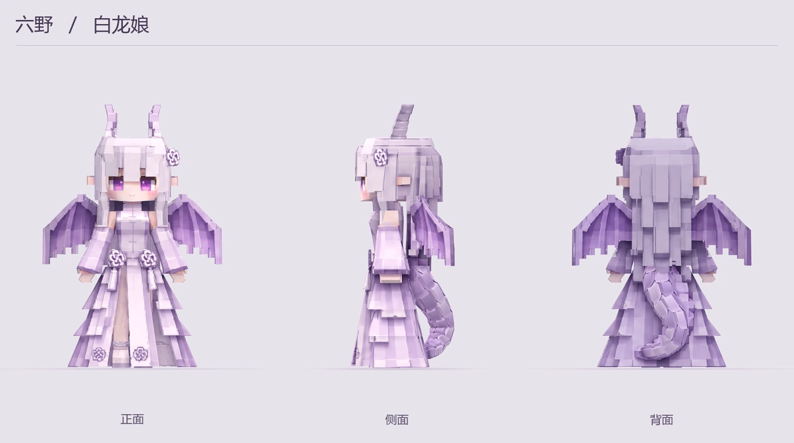

# 白龙娘 · 玩家模型

按 **F5** 在第一人称、背面跟随、正面观察之间切换。第一人称显示模型包的袖口和手；第三人称能看到持物、迈步、蹲伏和挥镐。按 **E** 打开背包，预览会随角色和装备一起变化。双翼从肩后展开，侧面能看到翼根，九节尾巴从长发下方卷回裙摆。

[六秒转台与动作](media/field-models/turntable.mp4) · [游戏实景](media/field-models/world.webp) · [背包装备预览](media/field-models/inventory.webp)

## 使用同一个模型包

- **六野**：打开「选项 → 角色模型 → 导入 YSM ZIP」。选择会保存在当前浏览器，与世界存档分开。导入失败会保留当前角色；「恢复白龙娘」切回内置模型。
- **Minecraft / Yes Steve Model**：把 [pearl-dragon.zip](../public/models/pearl-dragon.zip) 放入游戏实例的 `config/yes_steve_model/custom/`，在模组的模型选择界面选择「六野 · 白龙娘」。ZIP 是 [YSM 官方支持的分发格式](https://yesstevemodel.github.io/en/wiki/type/)。
- **Blockbench**：打开[可编辑工程](../art/models/pearl-dragon.bbmodel)。工程内嵌贴图与第三人称动画；第一人称手臂在 ZIP 内单列。人物造型参考 ZipZipPipe 的 GPT 白龙设定，方块几何、像素贴图和动作均为本项目制作。

六野读取带 `ysm.json` 清单的未加密 ZIP，支持子目录、Bedrock 方块骨架、旋转轴、两种 UV、透明 PNG、默认皮肤与数值关键帧。第三方模型使用其自带的动作；缺少动作时保持对应骨骼的基础姿势。MoLang 表达式、外部控制器、粒子和加密 `.ysm` 留给 Minecraft 模组运行。

## 制作与验证

`python tools/build-pearl-dragon.py`（需要 Pillow）生成模型包。包内有主角与第一人称两份几何、512 × 256 贴图以及动作文件。主角使用 31 根骨骼、123 个方块。运行 `node tools/editable-dragon.mjs` 会在后台 Edge 中请 Blockbench 的 Bedrock 导入器实际读包，保存带贴图和动作的编辑工程。

这一版用 Blockbench 5.2.2 读回了全部方块和 7 个第三人称动作条目。六野的导入器也读取了 [YSM 官方示例](https://github.com/YesSteveModel/YSM-Utils-Plugins/tree/2.0/assets/default) 的玩家几何、第一人称手臂、动画和皮肤。实机检查覆盖六野的视角切换、背包、导入、坏包保留原角色、刷新与重置；Minecraft 模组端尚未启动实测。

## 牧场与村庄

牛、猪、绵羊和鸡保留原有的行走关节，增加角、口鼻、羊毛或羽翼等物种细节。村民用草帽、围裙、眼镜和渔具区分职业。

