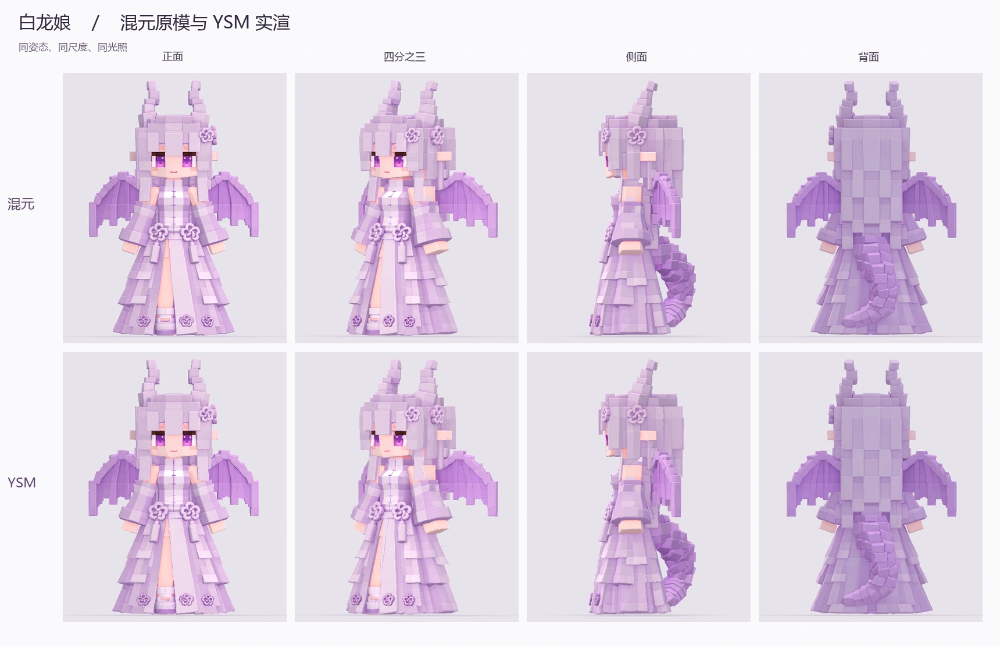
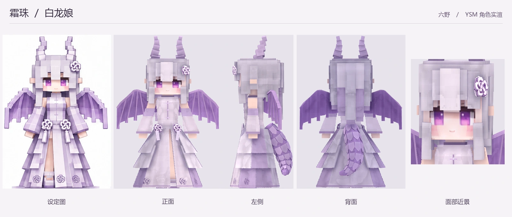

# 霜珠 · 白龙娘

[混元原模 / 成品同机位对照](media/pearl-hy/hy-native.webp) · [六秒转台与行走、挥手](media/pearl-hy/turntable.mp4) · [下载 YSM 包](../public/models/pearl-dragon-hy.zip) · [Blockbench 工程](../art/models/Pearl-Dragon-HY.bbmodel)



**在另一台机器看效果**：打开六野，按两次 **F5** 看正面，按 **E** 看背包预览。曾经导入过其他角色，可以在「选项 → 角色模型 → 恢复白龙娘」切回。也可以直接用 Blockbench 打开上方工程，贴图和第三人称动作均已内嵌。游玩和编辑都无需混元源文件。

**Minecraft Java / YSM**：将 ZIP 放进实例的 `config/yes_steve_model/custom/`，执行 `/ysm model reload`，在模型菜单选择「六野 · 白龙娘」。如果已有同名旧包，先移出旧包。[官方模型格式和安装目录](https://yesstevemodel.github.io/wiki/type/)

## 造型以混元原模为准

混元 GLB 有 1,998,136 个三角面。转换时沿原表面合并近似共面的区域，再在肩、肘、衣片和尾节的转动处切开并封口。模型正面的眼形、嘴形，袖口的倾角、裙摆的开衩、侧面的翼尖和回勾的尾巴都取自这张网格。面片贴图从原始 4096² 贴图重新采样。近看时，花扣的小圆角和衣片交界仍比原模硬一些。

「大正女仆酒狐」的 Bedrock 工程用来对照侧发、前臂、眼部表现与分段尾巴的组织方式。白龙娘的眼部变化使用局部覆盖；常态保留混元的脸。正面开衩中露出的鞋跟随同一条腿，左右袖、前裙和七段尾链分别运动。第一人称只加载手臂、前臂与握持点。第一人称动作沿用 [YSM 官方 Default 的 CC0 手臂动画](https://github.com/YesSteveModel/YesSteveModel/tree/15c2c25f5b50f54ee099bc474483dc4b588d956d/src/main/resources/assets/ysm/builtin/default)。



第三人称模型含 **15,618 个三角面、33 根骨骼、20 个动作**，共用一张 2048 × 4096 图集。包采用 spec 2 清单和 Bedrock 单面 UV；六野按骨骼合并渲染，角色每遍 29 次绘制。[Blockbench 5.2.2 实际视窗](media/pearl-hy/blockbench.webp)中已打开随包工程，Bedrock 几何导入和回导通过；游玩检查在六野完成。查看[第三人称实景](media/pearl-hy/field.webp)、[背包预览](media/pearl-hy/inventory.webp)及[帧时采样](media/pearl-hy/performance.md)。

## 从源网格重新制作

在仓库根目录用 Python 3.12 虚拟环境运行以下命令。前两个命令重建模型包；导出可编辑工程需要已安装的 Microsoft Edge 和可访问的 Blockbench 网页版。四机位对照在本机读取 GLB。

```sh
python -m pip install -r tools/pearl_hy/requirements.txt
python tools/pearl_hy/build.py "path/to/hunyuan.glb"
node tools/editable-dragon.mjs public/models/pearl-dragon-hy.zip art/models/Pearl-Dragon-HY.bbmodel
node tools/pearl_hy/review.mjs test-results/pearl-hy --motion
node tools/pearl_hy/reference.mjs "path/to/hunyuan.glb" test-results/pearl-hy/final-compare
python tools/pearl_hy/sheet.py
```

[早期白龙娘与牧场生物](pearl-dragon-0147.md)
