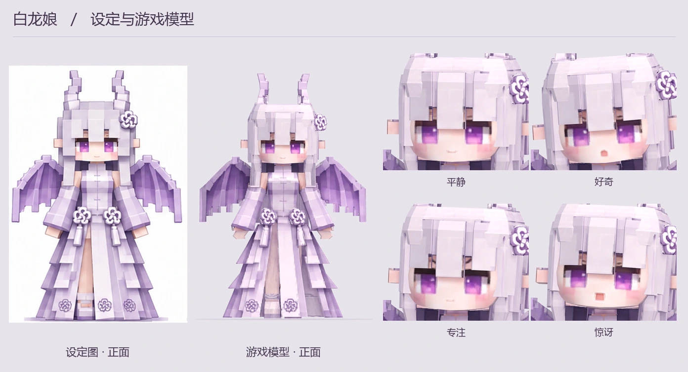
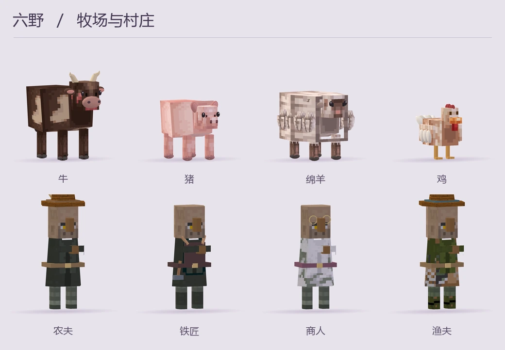

# 白龙娘 · 玩家模型

按 **E** 看她偏头打量背包，按 **F5** 切到正面观察。待机时嘴角带笑，挥镐时双眼收窄，受到伤害会短暂睁圆眼睛再放松。四种表情都有各自的眉形、视线和嘴形。

刘海有齐切的厚度，后发分层垂到腰间。方角翼尖之间留出阶梯缺口，两层侧裙压在长裙上；转到侧面，可以看到翼膜的折面和尾巴向后弯出的弧度。

[设定与实渲的同尺度三视图](media/field-models/pearl-ortho.webp) · [六秒转台与动作](media/field-models/turntable.mp4) · [素模](media/field-models/pearl-clay.webp) · [游戏实景](media/field-models/world.webp) · [背包预览](media/field-models/inventory.webp)

## 使用同一个模型包

- **六野**：打开「选项 → 角色模型 → 导入 YSM ZIP」。选择会保存在当前浏览器，与世界存档分开。导入失败会保留当前角色；「恢复白龙娘」切回内置模型。
- **Minecraft / Yes Steve Model**：把 [pearl-dragon.zip](../public/models/pearl-dragon.zip) 放入游戏实例的 `config/yes_steve_model/custom/`，在模组的模型选择界面选择「六野 · 白龙娘」。ZIP 是 [YSM 官方支持的分发格式](https://yesstevemodel.github.io/en/wiki/type/)。
- **Blockbench**：打开[可编辑工程](../art/models/pearl-dragon.bbmodel)。工程内嵌贴图与第三人称动画；第一人称手臂在 ZIP 内单列。人物造型参考 ZipZipPipe 的 GPT 白龙设定，方块几何、像素贴图和动作均为本项目制作。
- **Blender**：导入[已绑定动作的 GLB](../art/models/pearl-dragon.glb)，可直接编辑两颊、发束、裙片与翼膜的网格。

六野读取带 `ysm.json` 清单的未加密 ZIP，支持子目录、Bedrock 方块骨架、旋转轴、两种 UV、透明 PNG、默认皮肤与数值关键帧。第三方模型使用其自带的动作；缺少动作时保持对应骨骼的基础姿势。MoLang 表达式、外部控制器、粒子和加密 `.ysm` 留给 Minecraft 模组运行。

## 制作与验证

[正面](../art/models/pearl-target-front.png)、[侧面](../art/models/pearl-target-side.png)和[背面](../art/models/pearl-target-back.png)共用一条脚底基线。`tools/pearl_form.py` 以图上的坐标定义每层发片、喇叭袖、裙摆与翼尖的宽度、深度和遮挡关系；脸颊和下巴单独塑形。图中可见的色块烘到对应网格的 UV 上，遮住的面使用[补充材质](../art/models/pearl-paint.png)。转动角色时，颜色跟随该表面。四种表情共用[设定图的眼睛](../art/models/pearl-eye.png)，由动作切换。

修改后运行 `python tools/build-pearl-dragon.py`（需要 Pillow、NumPy）重新烘焙并生成 YSM 包，含人物、第一人称手臂、图集和动作。

`node tools/editable-dragon.mjs` 使用 Blockbench 的 Bedrock 导入器读包，保存内嵌图集的可编辑工程。本版通过 Blockbench 5.2.2 导入并回读了全部面件与 8 个第三人称动作。

运行 `node tools/pearl-clay.mjs` 可从六野的实渲网格导出 GLB。Blender 5.2.2 已导入网格、内嵌图集与 8 个动作。模型包使用带透明裁边的 Bedrock 面；六野通过附带的顶点数据还原曲面深度与下颌法线。六野端使用后台 Edge 检查视角、背包、受伤表情及模型导入；Minecraft 模组端尚未实机测试。

## 牧场与村庄

牛、猪、绵羊和鸡保留原有的行走关节，增加角、口鼻、羊毛或羽翼等物种细节。村民用草帽、围裙、眼镜和渔具区分职业。

