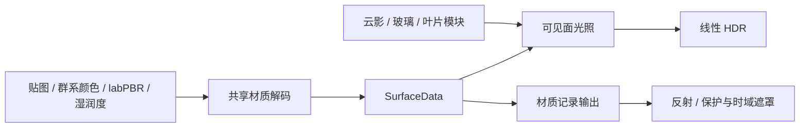

# 表面材质与渲染流程重构

0.138 将地形、原生树叶 / 草花及远景表面的材质解码、光照和数据输出拆成项目维护的程序阶段。该批验收结构变化与行为一致性，整体 Photon 画面目标仍未完成。

## 材质程序所有权

这些表面统一通过 `surface-material.js` 创建。Three.js 的材质类继续负责贴图与灯光 uniform 上传、几何和阴影适配；实际表面顶点 / 片元正文由项目的 `surface-template.js` 和 `surface-lighting.js` 管理，不再以替换 Three 灯光循环内部句子的方式组合照明。

`surface-program.js` 负责有限的命名阶段、共享 uniform 绑定和程序缓存键。云影与玻璃过滤、叶片透射、风动和远景叶片以独立模块注册；未知阶段、重复模块及冲突的独占阶段明确报错。低层坐标、贴图、法线和阴影声明仍复用 Three shader chunks；水、普通玻璃、独立模型及部分阴影桥接保留原宿主适配路径，后续继续迁移。

材质参数解码只有一个入口：纹理、群系颜色、labPBR 和湿润响应生成 `SurfaceData`。它明确区分线性 Rec.709 颜料、视空间着色法线、几何可见性、已平方的天空 / 方块光级、光学参数及自发光。方向光的高光、漫反射分配与本地点光沿用原有响应。

图中表示程序职责，两个输出是明确的程序变体。材质记录变体在编译阶段选择无光照输出，共享实际法线 / 光学解码与顶点形变；不再克隆完整可见面编译链后搜索材质标记并插入提前返回。紧凑记录复用原有三 / 四附件，布局由 `surface-data.js` 定义，包含遮罩、sRGB 颜料与类别、世界法线与天光，以及可选 labPBR 原始参数。天光通道为材质解码后平方光级的平方根，包含资源包可见性修正，不是未经处理的原始顶点字节。

风动的可见 / 云影 / 阴影坐标与逻辑体素光照采样锚点明确分开。重构时发现旧编译链先写风动位置、随后又以逻辑位置覆盖 `vLightPosition`；直接改变代码顺序会使叶片透射采样跨到不同体素。当前显式保留逻辑采样锚点。

## 帧流程依赖

`render-pipeline.js` 在安装 pass 前验证数据来源与顺序。当前逻辑流程为：

`forward-scene → surface-records → contact-occlusion → reflections → atmosphere → temporal → bloom → exposure → spatial-aa → display`

每个阶段声明读写的逻辑资源，缺少生产者或重复输出会在创建时失败。实际颜色交换、可选 pass 的旁路和资源生命周期继续由 EffectComposer 负责，没有第二套渲染目标或额外场景绘制。`composer.pipeline.describe()` 可检查当前阶段、启用状态及依赖。

当前仍是前向着色，紧凑材质记录覆盖反射 / 湿面需要的选区。AO 仍位于颜色之后，本批没有实现 Photon 的 bent normal / 环境透射照明或完整延迟渲染。下一步应扩展几何与可见性输入，再将环境遮蔽接入自有光照阶段；该工作现在有明确的材质接口和光照正文可修改。

## 验证

重构前保存自然日间森林和湿面材质场景的原始缓冲。固定种子、相机、时间和正常光照 / 风动，关闭最终 AA / 锐化，并仅在原始缓冲对照绘制中关闭随机体积云颜色；云影、天空、几何与材质保留。视口为 900×650，每个场景显示 441 个近景区块、169 片远景。

第一轮材质记录相同，但森林 HDR 出现明显差异，最大通道误差约 0.645。追踪生成的旧 / 新着色器后定位到上述风动光照采样锚点的覆盖次序；修正后，森林和湿面的主视图 HDR、水面捕获 HDR 及三份材质记录共十份缓冲均逐字节相同。最终版本已再次通过严格缓冲相等断言。两组场景用于内部行为回归，不要求程序化地形与真实 Minecraft 一致，也不代表 Photon 画面验收。

验证还覆盖：

- 四项 Node 测试：材质创建与环境 uniform 引用、共享解码与记录变体、模块顺序与独占阶段冲突、依赖失败时不修改 composer，已加入常规 `npm test`。
- 叶片深度预绘制：900×650 和 713×509，可见面 / 阴影风动与水面捕获的 HDR / 深度一致。
- 原生光学与材质包：几何遮蔽影响漫反射而不污染颜料 / 自发光，金属 / 宝石 / 木材高光，玻璃滤色与不透明遮挡；labPBR 导入、持久化、上下文恢复及 16 / 32 / 64 像素 UV。
- 叶片方向漫反射分配和风动的画质 / 天气 / 显卡恢复。最终直接光参数精简后，重复验证缓冲一致性和方向漫反射行为。
- 最终生产构建通过普通 UI 导入湿面场景、实际材质绘制、显卡上下文恢复及 v16 存档导出检查，不依赖开发调试接口。

## GPU 成本与交付边界

原生 1920×1080 森林采样中，渲染目标合计 301,568,680 字节、独立纹理 14,983,610 字节、几何 440,832,748 字节、程序数 58，与旧版同条件资源记录相同。独立运行出现较大计时波动，因此另外在同一会话、同一场景中依次测旧版颜色程序 / 新版 / 旧版颜色程序。旧版源码快照固定到 `e68ca6f5156d84e58ad98cdfdb66040f1051ccf3`，当前 uniform 生产者、深度与材质记录程序全程相同；这个实验只隔离颜色程序成本，不等于整个旧渲染器与新版的总帧率对比。

每个窗口预热 80 帧，再采样 120 帧 GPU timer，busy / disjoint 均为零。最终结果如下，单位 ms：

| 程序窗口 | 主视图中位数 | 主视图 P95 | 水面捕获中位数 | 水面捕获 P95 |
| -------- | -----------: | ---------: | -------------: | -----------: |
| 旧版 A   |        4.327 |      4.538 |          4.229 |        4.511 |
| 新版     |        4.902 |      6.231 |          4.884 |        7.293 |
| 旧版 B   |        4.364 |      4.678 |          4.257 |        4.966 |

新版每个视图的场景阶段仍增加约 0.55～0.66 ms，且尾部波动更高；该批不能宣称性能提升或无成本重构。没有新增场景 pass 或目标，但程序组织变化仍可能影响驱动编译与寄存器分配。已缩减直接光函数的参数，实测未证实速度收益；后续应在保留共享解码和明确接口的前提下继续处理这一成本。

本机原始证据位于 `C:/Users/aentrozhou/.codex/artifacts/hexminecraft-surface-pipeline-0.138/`，包括原始缓冲、计时、构建哈希和各次 runner 清理记录。最终发布包检查前核对 942 个输入文件均无漂移。运行使用无头 Chrome 与 Pointer Lock DOM mock，GPU 流程顺序执行；所有测试自有进程已退出，5191 / 5193 无遗留监听，用户 5173 服务未接管。

原有 Photon 派生照明的许可继续见 `public/licenses/PHOTON-NOTICE.md` 和 `photon.txt`。Three.js 适配的灯光接口与循环保留 MIT 许可，见 `public/licenses/three.txt`。
